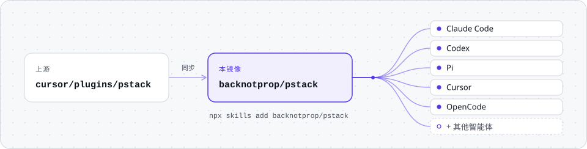

> 简体中文译本：本仓库 `pstack-cn` 依据 backnotprop/pstack 的固定 commit `9cd6939b766cb920f1c44970d7c7ee1ec28bd0d6`（插件 `0.15.36`）翻译，正文已由英文译为中文。原有 pstack 身份、命令与来源链接保留；下列安装命令仍指向原插件或镜像，不代表已验证中文仓库安装。来源与中文使用说明见 [wiki/index.html](./wiki/index.html)。下方同步标记中的“unchanged”描述源镜像的英文基线，译文不再是未经修改的英文原文。

<!-- mirror:start — this top section is specific to the mirror. Everything after mirror:end is the upstream README from cursor/plugins/pstack, unchanged. To sync with upstream, follow MIRROR.md. -->
<h1 align="center">pstack — 独立镜像</h1>

<p align="center">
  <a href="https://github.com/cursor/plugins/tree/main/pstack">
    <picture>
      <source media="(prefers-color-scheme: dark)" srcset="mirror-assets/header-dark.svg">
      
    </picture>
  </a>
</p>

<p align="center">
  Poteto 的 cursor/plugins/pstack 的<b>镜像</b>，保持同步以供独立使用。由 Plannotator 赞助。
</p>

<p align="center">
  <a href="https://github.com/backnotprop/plannotator"><picture>
    <source media="(prefers-color-scheme: dark)" srcset="mirror-assets/sponsor-plannotator-dark.svg">
    
  </picture></a>
  <a href="https://plannotator.ai/inbox/"><picture>
    <source media="(prefers-color-scheme: dark)" srcset="mirror-assets/sponsor-inbox-dark.svg">
    
  </picture></a>
</p>

<p align="center">
  Poteto 的 Bro Skill 由我创建：<a href="https://github.com/backnotprop/bro">backnotprop/bro</a>（此处“我”指镜像维护者 backnotprop）
</p>

<a id="install"></a>

## 安装

pstack 是一组普通的 [Agent Skills](https://agentskills.io) 文件（`skills/<name>/SKILL.md`）。你不必使用 [Cursor](https://github.com/cursor/plugins/tree/main/pstack)。[`skills` CLI](https://skills.sh) 可将它们安装到 Claude Code、Codex、Pi、Cursor、OpenCode 及其他智能体中：

```bash
npx skills add backnotprop/pstack
```

CLI 会列出所有技能供你搜索。先选择想要的技能，再选择使用的智能体。

<a id="skills"></a>

## 技能

Cursor 原版 README 见[本页下方](#pstack)。

这些技能不会调用其他 pstack 技能，因此都能独立使用：

`unslop`、`bro`、`how`、`tdd`、`typescript-best-practices`、`arena`、`swarm`、`interrogate`、`reflect`、`show-me-your-work`、`figure-it-out`、`automate-me`、`correct`、`benchmark-checklist`、`in-your-own-words`、`sharpen`、`statechart`

有些技能会调用其他技能，请一起安装：

| 技能 | 同时安装 |
|---|---|
| `teach` | `how`、`why` |
| `why` | `how` |
| `technical-writing` | `unslop` |
| `architect` | `arena`、`how` |
| `blast-radius` | `arena`、`how`、`why`、`unslop` |
| `create-verification-skill` | `maintain-verification-skill` |
| `create-formal-verification-skill` | `maintain-formal-verification-skill`、`statechart` |
| `ketchup` | `bro` |
| `ketchup-video` | `ketchup`、`bro` |
| `poteto-mode` | 所有 `principle-*` 技能及大多数其他技能 |
| `poteto-help` | 你想咨询的技能 |

启动子代理的技能会参考 `poteto-mode` 的子代理部分，选择每个子代理的推理强度。没有 `poteto-mode` 时，使用默认强度。

<a id="what-this-mirror-changes"></a>

## 这个镜像修改了什么

许多技能原本只适用于 Cursor，现已改写为可在任何智能体运行环境中使用。

镜像还包含两项尚未进入上游的社区修复：

- `no-comments` 无法核查外部规则（依赖、平台或协议）的注释时，会保留并标记审查，而不是删除。被否决的审查也不再停止整个运行。（[#14](https://github.com/backnotprop/pstack/issues/14)）
- `statechart` 可以在 Windows 上运行：不再需要 `/bin/sh`，可读取 Windows 换行的 TLC 输出，并在运行被终止后清理临时目录。补丁由 [@yasuyuki](https://github.com/yasuyuki) 提供。（[#17](https://github.com/backnotprop/pstack/issues/17)）
<!-- mirror:end -->

---

<a id="pstack"></a>

# pstack

[阅读 Pstack 博客](https://x.com/poteto/article/2094457600259842065?lang=en)

我是 [poteto](https://x.com/poteto)。我不是总裁或 CEO，但曾在 Meta、Netflix 和 Cursor 处理过数百万行代码。我也是 React 核心团队成员，参与构建和维护 React Compiler。

越来越多人觉得 AI 写了太多劣质代码。我同意。我不想像二十个只顾堆砌代码的人组成的团队那样交付。没有质量的吞吐量不是我追求的目标。想要快，先深入。

**pstack 是我的答案。** 这些正是我每天在 Cursor 交付高质量代码时使用的技能，它们把 Cursor 变成真正的工程团队。目标不是最大化代码行数，恰恰相反：pstack 帮你写得更少，质量更高。

**pstack 让你放心并行。** 当你能深入使用一个智能体，并相信它能写出优质、可验证的代码时，才能真正自信地并行。用 `poteto-mode` 启动多个智能体，相信它们会将严谨的工程原则应用到工作中。

**Cursor 让你兼得各家之长。** 每个前沿模型都有优劣。pstack 可以搭配任何模型。事实上，我的很多技能采用多模型工作流，以发挥每个模型的独特优势。

Fork 它，改进它，让它适合你。欢迎 PR！

<a id="install-1"></a>

## 安装

```bash
/add-plugin pstack
```

在 Claude Code 中：

```bash
/plugin marketplace add cursor/plugins
/plugin install pstack@cursor-plugins
```

Claude Code 默认关闭第三方 marketplace 的自动更新，因此 pstack 会停留在安装时的版本。要开启，运行 `/plugin`，打开 **marketplaces**（插件市场）标签页，选择 `cursor-plugins`，再选择 **enable auto-update**（启用自动更新）。要手动更新一次，运行 `claude plugin update pstack@cursor-plugins`。

Claude Code 会给插件命令和智能体添加前缀，因此 `/poteto-mode` 变为 `/pstack:poteto-mode`。[Claude Code 适配说明](./docs/harness/claude-code.md)映射了其他所有 Cursor 名称。在 Claude Code 中，`/pstack:setup-pstack` 将模型选择写入 `~/.claude/rules/pstack-models.md`；需要 Bugbot 或自动化等 Cursor 专有功能的步骤，会被跳过并附一行说明。

Claude Code 从仓库根目录下的 [`harness/pstack/`](https://github.com/cursor/plugins/tree/main/harness/pstack) 安装 pstack 的生成副本，包括本 README 和指南。修改 pstack 后，应在仓库根目录运行 `node scripts/generate-pstack-harness-trees.mjs` 并提交结果。生成副本过时时，CI 会失败。

<a id="get-started"></a>

## 开始使用

只需两步：

1. 运行 [`/setup-pstack`](./skills/setup-pstack/SKILL.md)，选择推理预算和模型。
2. 做任何需要严谨处理的工作时，使用 [`/poteto-mode`](./skills/poteto-mode/SKILL.md)。

初次接触？[pstack 指南](./docs/guide/README.md)带你完成第一个真实任务，从设置、提示词到验证和通宵运行。遇到困难，或不确定哪项技能合适？问 [`/poteto-help`](./skills/poteto-help/SKILL.md)。

仅此而已。其他技能按情境使用，模式技能会在需要时替你调用。开箱即用的模式按模型优势分工：代码任务子代理（功能、重构、缺陷修复、性能、爬坡优化）使用 Grok，最困难的改动、文字和判断使用 Opus 5.5。默认审查小组为 Opus 5.5 / Grok。[`/setup-pstack`](./skills/setup-pstack/SKILL.md)可修改任何一项。

<a id="usage"></a>

## 用法

在任务开始时使用 [`/poteto-mode`](./skills/poteto-mode/SKILL.md)。它阅读请求，选择操作手册，并在各步骤需要时运行其他技能。

输入任务前，从 `/` 菜单选择 `/poteto-mode`，让 Cursor 将技能附加到消息。

<a id="just-use-poteto-mode"></a>

### 直接用 [`/poteto-mode`](./skills/poteto-mode/SKILL.md)

这项技能是主要快捷入口。需要智能体做严谨工程工作时，我都会用它。它包含二十三份操作手册：

```
/poteto-mode 这个 pr 有个隐蔽缺陷：即使空闲，滚动位置也会每隔 750ms 漂移。
先复现，再修复并验证。
```

```
/poteto-mode 我要睡觉了。即使 ci 偶发失败，也要把堆叠合并。
我希望早晨前全部合并。
```

<details>
<summary>二十三份操作手册</summary>

| 操作手册 | 适用情境 |
|---|---|
| [调查](./skills/poteto-mode/playbooks/investigation.md) | 只读问题：x 如何工作、y 为何这样构建、我们确定吗。 |
| [缺陷修复](./skills/poteto-mode/playbooks/bug-fix.md) | 复现缺陷，定位根因，用运行时证据修复。 |
| [性能问题](./skills/poteto-mode/playbooks/perf-issue.md) | 追踪已测量的缓慢，并相对基线改进。 |
| [爬坡优化](./skills/poteto-mode/playbooks/hillclimb.md) | 科学、持续地朝目标改善一项指标，循环检验假设，测量前后差异，每项接受的收益一个提交。 |
| [运行时取证](./skills/poteto-mode/playbooks/runtime-forensics.md) | 通过观测诊断实时症状，如泄漏、空闲 CPU 空转、视觉异常。 |
| [跟踪取证](./skills/poteto-mode/playbooks/trace-forensics.md) | 诊断捕获的性能剖析产物，如 cpuprofile、trace、spindump、堆快照。 |
| [功能开发](./skills/poteto-mode/playbooks/feature.md) | 从明确命名的数据形态构建新增或变化的行为。 |
| [重构](./skills/poteto-mode/playbooks/refactoring.md) | 保持行为不变，改变结构或形态。 |
| [原型](./skills/poteto-mode/playbooks/prototype.md) | 制作可丢弃草案，以低成本作出设计或行为决策，或通过观测解决需实证的分歧。 |
| [视觉一致性](./skills/poteto-mode/playbooks/visual-parity.md) | 两种实现之间逐像素等价的 UI。 |
| [编写技能](./skills/poteto-mode/playbooks/authoring-a-skill.md) | 编写或编辑 SKILL.md。 |
| [评估](./skills/poteto-mode/playbooks/eval.md) | 盲测技能或提示词改动对智能体行为的影响。 |
| [跟进 PR（Babysit）](./skills/poteto-mode/playbooks/babysit.md) | 推进 PR 或堆叠至可合并：冲突、审查讨论、CI。 |
| [交付（Shipping）](./skills/poteto-mode/playbooks/shipping.md) | 独立验证全绿堆叠，再从底向上合并连续通过验证的部分，默认使用 GitHub，Origin 可用时使用它。 |
| [自主运行](./skills/poteto-mode/playbooks/autonomous-run.md) | 持续推进长任务直到完成，不中途停止。 |
| [编排](./skills/poteto-mode/playbooks/orchestrate.md) | 交给一个协调聊天的常驻项目：跨多天、大量堆叠 PR、成组子代理。 |
| [完全自动驾驶（autopilot-full）](./skills/poteto-mode/playbooks/autopilot-full.md) | 每个独立 PR 一位负责人，推进至合并。每个代码就绪 HEAD 由验证组检查，补丁后续每次变化都重新检查。 |
| [PR 栈自动驾驶（autopilot-stack）](./skills/poteto-mode/playbooks/autopilot-stack.md) | 不合并的 autopilot-full：构建并验证 PR，供操作者审查和落地，只有依赖另一个 PR 时才堆叠其上。 |
| [会话接续](./skills/poteto-mode/playbooks/session-pickup.md) | 恢复或接手前一个智能体未完成的工作。 |
| [安全暂停](./skills/poteto-mode/playbooks/pause-safely.md) | 干净地挂起进行中工作，以便稍后恢复。 |
| [多阶段计划](./skills/poteto-mode/playbooks/multi-phase-plan.md) | 跨阶段或堆叠 PR 的工作。 |
| [工作树清理](./skills/poteto-mode/playbooks/worktree-cleanup.md) | 在安全门禁下删除已合并或废弃工作树及闲置 iOS 模拟器，回收磁盘。 |
| [创建 PR](./skills/poteto-mode/playbooks/opening-a-pr.md) | 从小而有序的提交创建就绪 PR，采用 Conventional Commits 标题和简报式正文。每份其他操作手册的结尾都会调用它。 |

</details>

调用后，它会：

1. 将任务匹配到[操作手册](./skills/poteto-mode/playbooks/)，打开待办列表，最前面的条目原样复制自操作手册步骤。
2. 在各步骤执行时路由到其他技能。
3. 面向使用者和维护者撰写去除冗余套路的回复。

完整规则和操作手册见 [`skills/poteto-mode/SKILL.md`](./skills/poteto-mode/SKILL.md)。

要让 [`/poteto-mode`](./skills/poteto-mode/SKILL.md) 跨轮次持续生效，从 `/` 菜单选择它，按 Option+Enter（Mac）或 Alt+Enter（Windows），而不是 Enter。这样会设为[自定义模式](https://cursor.com/docs/skills#using-a-skill-as-a-custom-mode)，Cursor 的 Agents Window（智能体窗口）和 CLI 都提供此功能。退出模式前，它会在每轮对话中留在上下文。只按 Enter 仅附加到一条消息。

[`/poteto-mode`](./skills/poteto-mode/SKILL.md)与 Cursor 的 `/loop` 命令配合效果很好。你可以让 Cursor 连续工作数小时，同时保持严谨。

<a id="skills-1"></a>

## 技能

[`/poteto-mode`](./skills/poteto-mode/SKILL.md)会在步骤需要时替你运行其中大多数（`how`、`why`、`architect`、`arena`、`swarm`、`interrogate`、`unslop`、`no-comments`、`technical-writing`、`tdd` 和各原则）。下表用于你想直接调用时：

```
/how 我们如何取消运行？逐一查找每次运行以取消时，是否有 n+1 问题？
```

```
/interrogate 审查这个 pr。
```

<details>
<summary>全部技能</summary>

| 技能 | 使用时机 |
|---|---|
| [`/poteto-mode`](./skills/poteto-mode/SKILL.md) | 任何非平凡任务的默认入口。 |
| [`/poteto-help`](./skills/poteto-help/SKILL.md) | 刚接触 pstack，或不确定哪项技能、操作手册、原则合适。查清你想做什么，回答相关问题，给你一条可输入的提示词。只在输入 `/poteto-help` 时运行。 |
| [`/in-your-own-words`](./skills/in-your-own-words/SKILL.md) | 希望智能体开始前复述你的目标和问题。只在输入 `/in-your-own-words` 时运行。 |
| [`/sharpen`](./skills/sharpen/SKILL.md) | 希望发送前让提示词更深入而非更庞大：专业人士还会做什么、从哪些原始材料着手、采用什么方法工具，以及什么外部检查能证明正确。返回改写后的提示词，保留选择空间，不执行任务。只在输入 `/sharpen` 时运行。 |
| [`/how`](./skills/how/SKILL.md) | 想了解某个子系统如何工作。 |
| [`/why`](./skills/why/SKILL.md) | 想知道为何这样构建。运行时发现可用 MCP，并行查询各证据类别：版本控制、问题跟踪、长篇文档、即时聊天、基础设施可观测性、错误跟踪、分析数据仓库。 |
| [`/recall`](./skills/recall/SKILL.md) | 开始或恢复工作，想根据自己的聊天历史及共享记录重建某主题的近期上下文，得到紧凑的现状简报。 |
| [`/ketchup`](./skills/ketchup/SKILL.md) | 想用通俗语言和小图示了解本聊天自你上一条消息以来的变化，列出所有等待你决定的事项，并让你仅凭回复就能决定，即使因此回复较长。 |
| [`/ketchup-video`](./skills/ketchup-video/SKILL.md) | 想把 `/ketchup` 回顾变成带字幕的简短幻灯视频，等待你决定的事项在下方用文字列出。 |
| [`/blast-radius`](./skills/blast-radius/SKILL.md) | 改动看似很小，想知道还可能破坏什么，并用运行代码证明确保安全的关键事实，而非仅作断言。 |
| [`/architect`](./skills/architect/SKILL.md) | 即将编写跨函数边界的代码，希望先确定调用方用法、类型及模块结构。 |
| [`/arena`](./skills/arena/SKILL.md) | 希望 N 次并行尝试同一任务，再融合各自最佳部分。 |
| [`/swarm`](./skills/swarm/SKILL.md) | 希望 N 个并行工作代理处理不同切片或竞赛，再汇总一份报告。 |
| [`/interrogate`](./skills/interrogate/SKILL.md) | 已有差异，希望不同模型尝试击破，只保留运行能证明的发现。 |
| [`/automate-me`](./skills/automate-me/SKILL.md) | 想根据自己的真实工作方式起草个人 `-mode` 技能。 |
| [`/make-bot-ui`](./skills/make-bot-ui/SKILL.md) | 想构建按钮通过 webhook 唤醒 Grok Bot 的页面或仪表盘，包括发送方密钥交接及 Tailscale。 |
| [`/setup-pstack`](./skills/setup-pstack/SKILL.md) | 想按角色选择 pstack 使用的模型。它检测模型并写入配置规则。 |
| [`/reflect`](./skills/reflect/SKILL.md) | 长任务已完成，希望把做法提炼为技能编辑。 |
| [`/correct`](./skills/correct/SKILL.md) | 反复纠正智能体同类错误。从历史提炼错误类别，在有效的最高层级修复（架构优先，其次类型、lint、CI，再测试，文档最后），并维护规则与执行机制配对表。 |
| [`/teach`](./skills/teach/SKILL.md) | 想真正理解改动或子系统，而非只看摘要。运行 how + why，按图示逐步织成通俗讲解。 |
| [`/tdd`](./skills/tdd/SKILL.md) | 正在修复缺陷，且有低成本本地测试路径。先写失败测试，再修复。 |
| [`/benchmark-checklist`](./skills/benchmark-checklist/SKILL.md) | 运行了基准测试或测量加速、回归。在报告或据此行动前，审核数字：限制因素、调优、错误、重复运行、端到端意义。 |
| [`/no-comments`](./skills/no-comments/SKILL.md) | 审查前清理注释；启动 Comment Sicko，修复接受的发现，提议把注释声称的约束编码进结构。 |
| [`/typescript-best-practices`](./skills/typescript-best-practices/SKILL.md) | 阅读或编辑 TypeScript，将类型系统纪律落实为语法。 |
| [`/figure-it-out`](./skills/figure-it-out/SKILL.md) | 没有匹配的随附操作手册，需要为任务设计严谨、可审计的操作手册。 |
| [`/show-me-your-work`](./skills/show-me-your-work/SKILL.md) | 想要可审查的决策记录，记录到可提交的 TSV。 |
| [`/create-verification-skill`](./skills/create-verification-skill/SKILL.md) | 项目没有可脚本化证明应用行为的方法。为任意语言或平台生成项目内验证技能和功能图。 |
| [`/maintain-verification-skill`](./skills/maintain-verification-skill/SKILL.md) | 验证技能的功能图已偏离应用。先源码检查波次，再一轮实际操作，至多创建一份包含已证明修正的 PR。 |
| [`/create-formal-verification-skill`](./skills/create-formal-verification-skill/SKILL.md) | 测试无法触及让竞态、重试、状态机、解析器或不安全代码出错的情形。用适当工具验证一项性质，生成项目内技能以便每次改动重查。 |
| [`/maintain-formal-verification-skill`](./skills/maintain-formal-verification-skill/SKILL.md) | 形式化验证覆盖的代码自上次检查后变化。更新模型、运行环境或性质以匹配代码，重跑，并说明每次失败是验证漂移还是代码缺陷。 |
| [`/statechart`](./skills/statechart/SKILL.md) | 行为负责人需要看懂行为，而非阅读规格。检查 TLA+ 模型，把用户所见画成 Mermaid 状态图，标记每个违背规则的状态，并给出到达各状态的最短路径。 |
| [`/unslop`](./skills/unslop/SKILL.md) | 清理文字，去除 AI 写作痕迹。 |
| [`/bro`](./skills/bro/SKILL.md) | 希望用通俗、不带行话的人类语言重述上一条消息。 |
| [`/technical-writing`](./skills/technical-writing/SKILL.md) | 用于文档、RFC、README、PR 描述及提交消息的分层写作标准（Diátaxis + Google 开发者风格 + STE + Global English）。 |

</details>

<a id="examples"></a>

### 示例

通常我在任务开头输入 [`/poteto-mode`](./skills/poteto-mode/SKILL.md)，让它路由到操作手册。其他技能在步骤需要时触发。少数技能我会直接使用。

<details>
<summary>全部示例</summary>

```
缺陷修复：         /poteto-mode 这个 pr 有个隐蔽缺陷：即使空闲，滚动也会每隔 750ms 漂移。
                   先复现，再修复并验证。
性能问题：         /poteto-mode 大列表即使用了虚拟化，也要一两秒才能加载。
                   运行 cpu 跟踪，告诉我原因。
功能开发：         /poteto-mode 在功能开关后构建一个小功能，验证它确实有效。
原型：             /poteto-mode 构建两个 markdown 渲染器原型供比较。
                   每个原型派一个智能体。
多阶段：           /poteto-mode 把这些技能作为插件开源。不能泄露内部内容，
                   在临时目录工作，先给我看依赖图。
通宵运行：         /poteto-mode 我要睡觉了。即使 ci 偶发失败也要合并堆叠。
                   我希望早晨前全部合并。
babysit：          /poteto-mode 看看 pr 123 的状态。还有什么未解决？
视觉一致性：       /poteto-mode 开启这个标志后行间距太大。第二张图是正确的。
                   复现并修复，直到一致。
自主设计做法：     /poteto-mode 我要暂时离开。把所有调用方从同步 store 迁移到新的异步 store，
                   保持行为一致。我希望回来时能相信它做对了。
how：              /how 我们如何取消运行？逐一查询每次运行以取消时有 n+1 问题吗？
why：              /why 为什么这个功能开关还没开启？
architect：        把这套观测设计为高信噪比且无误报。先用 /architect 设计。
arena：            /arena 把我的提示词原样送入 arena。我想把它们的提案与你的比较。
swarm：            /swarm 用各自的 check.sh 检查 packages/ 下每个包。
                   每个包一个工作代理，汇成一份报告。
interrogate：      /interrogate 审查这个 pr。
tdd：              /tdd 实现
unslop：           能否清理并精简新增内容？
reflect：          /reflect 这花的时间太长了。记录学到的东西，避免下次重犯。
correct：          /correct
show-me-your-work：/show-me-your-work 保留决策记录，供我回来时审查。
automate-me：      /automate-me
帮助：             /poteto-help 我应该用哪项技能审查这个分支？
```

</details>

<a id="the-poteto-agent-and-comment-sicko-subagents"></a>

## `poteto-agent` 和 Comment Sicko 子代理

[`/poteto-mode`](./skills/poteto-mode/SKILL.md)在收到它的聊天中运行。该聊天负责操作手册、待办列表以及每次子代理启动。

pstack 还提供 [`subagent_type: "poteto-agent"`](./agents/poteto-agent.md)，作为运行期间所启动任务子代理的封装。它在做任何工作前完整阅读 `poteto-mode`，包括其中的原则索引。换成 `generalPurpose` 会跳过阅读并偏离规则。不要启动 `poteto-agent` 来运行操作手册本身。

[`/poteto-mode`](./skills/poteto-mode/SKILL.md)和 [`subagent_type: "poteto-agent"`](./agents/poteto-agent.md)使用同一封装。

pstack 还提供 [Comment Sicko](./agents/comment-sicko.md)，这是一个只读注释审查者，类型为 `subagent_type: "comment-sicko"`。通常通过 [`/no-comments`](./skills/no-comments/SKILL.md)调用，而不是直接启动。

<a id="principles"></a>

## 原则

二十四项简短技能，每项一条原则。`poteto-mode` 在正文内建立索引，并在任务开始时阅读。独立文件让其他技能可以按名称引用原则，也让索引能指向每条完整规则。

<details>
<summary>全部二十四条原则</summary>

| 原则 | 分组 | 规则 |
|---|---|---|
| [laziness-protocol](./skills/principle-laziness-protocol/SKILL.md) | 核心 | 优先删除，作出能解决问题的最小改动。 |
| [foundational-thinking](./skills/principle-foundational-thinking/SKILL.md) | 核心 | 写逻辑前应用：选择核心类型和数据结构，安排骨架与功能工作的顺序，询问并发参与者共享什么。选对数据结构，让下游代码自然明确。 |
| [redesign-from-first-principles](./skills/principle-redesign-from-first-principles/SKILL.md) | 核心 | 重新设计，仿佛需求从第一天起就是基础假设，而不是后来附加。 |
| [attack-the-premise](./skills/principle-attack-the-premise/SKILL.md) | 核心 | 两次或更多修复共享同一前提，并在同一门禁失败时应用。在继续按该前提修复前，把前提写下来并直接检验。 |
| [subtract-before-you-add](./skills/principle-subtract-before-you-add/SKILL.md) | 核心 | 先移除冗余负担、重复验证器和桩引用，再在更简单的基础上构建。 |
| [minimize-reader-load](./skills/principle-minimize-reader-load/SKILL.md) | 核心 | 统计问题与答案间的层次，以及读者脑中的隐藏状态；合并只有一个调用方的封装，缩小可变作用域。 |
| [outcome-oriented-execution](./skills/principle-outcome-oriented-execution/SKILL.md) | 核心 | 用于有明确阶段边界的计划性重写和迁移。收敛到目标架构，不用一次性兼容代码维持平滑的中间状态。 |
| [experience-first](./skills/principle-experience-first/SKILL.md) | 核心 | 优先用户愉悦而非实现方便；交付更少但打磨好的功能，而非更多粗糙功能。 |
| [exhaust-the-design-space](./skills/principle-exhaust-the-design-space/SKILL.md) | 核心 | 在定案前构建 2–3 个竞争原型，并排比较。 |
| [build-the-lever](./skills/principle-build-the-lever/SKILL.md) | 核心 | 适用于所有非平凡工作，不限于批量任务：编辑、迁移、分析、检查。构建执行或证明工作的工具（codemod、脚本、生成器，或子代理遵循的技能），而非手动处理。工具是审查者可重跑的产物。 |
| [model-the-domain](./skills/principle-model-the-domain/SKILL.md) | 架构 | 把领域编码进结构，而非散落的条件判断。 |
| [boundary-discipline](./skills/principle-boundary-discipline/SKILL.md) | 架构 | 在系统边界（CLI、配置、网络、外部 API）集中防御检查；信任内部类型，把业务逻辑放在纯函数中。 |
| [type-system-discipline](./skills/principle-type-system-discipline/SKILL.md) | 架构 | 让非法状态无法表示，为语义基础类型加品牌标记，在边界解析外部数据，穷尽变体，从权威 schema 派生类型。 |
| [make-operations-idempotent](./skills/principle-make-operations-idempotent/SKILL.md) | 架构 | 无论之前部分运行过多少，最终都收敛到同一终态。 |
| [migrate-callers-then-delete-legacy-apis](./skills/principle-migrate-callers-then-delete-legacy-apis/SKILL.md) | 架构 | 同一轮迁移调用方并删除旧 API，不保留兼容层。 |
| [separate-before-serializing-shared-state](./skills/principle-separate-before-serializing-shared-state/SKILL.md) | 架构 | 先消除共享；只有单个共享写入者确为不变量时，才通过结构实现串行化。 |
| [prove-it-works](./skills/principle-prove-it-works/SKILL.md) | 验证 | 完成任务后、宣告完成前应用。针对真实产物验证（运行功能、读取实际值、检查差异），而非替代物、自我报告或“能编译”。 |
| [fix-root-causes](./skills/principle-fix-root-causes/SKILL.md) | 验证 | 把每个症状追溯到系统最先出错的地方，并在那里修复。只有所处理状态合法时，防御检查才算修复。 |
| [sequence-verifiable-units](./skills/principle-sequence-verifiable-units/SKILL.md) | 验证 | 用于多步骤工作（批量检查、迁移、一系列相似编辑），也用于组织提交和 PR 堆叠。拆成各自以可验证状态结束的小单元，下一单元前先检查，并安排交付顺序，让审查者看到序列本身的证明。 |
| [test-behavior-not-implementation](./skills/principle-test-behavior-not-implementation/SKILL.md) | 验证 | 编写、修改或保留测试时应用。断言代码用户能观察的行为，让测试在行为破坏时失败，仅内部变化时继续通过。 |
| [explain-the-number](./skills/principle-explain-the-number/SKILL.md) | 验证 | 信任、报告或依据测量数字行动前应用：加速、回归、吞吐量、延迟或评估结果。找到限制因素，并排除它测量了其他工作而非你以为的工作。 |
| [guard-the-context-window](./skills/principle-guard-the-context-window/SKILL.md) | 委派 | 将大批内容交给子代理；主聊天保留摘要，而非原始载荷。 |
| [never-block-on-the-human](./skills/principle-never-block-on-the-human/SKILL.md) | 委派 | 继续推进、展示结果，让人事后纠偏；仅对不可逆操作保留确认。 |
| [encode-lessons-in-structure](./skills/principle-encode-lessons-in-structure/SKILL.md) | 元原则 | 将规则编码为 lint、元数据标志、运行时检查或脚本，而不是增加文字。 |

</details>

<a id="not-shipped-here"></a>

## 此处未包含的内容

`poteto-mode` 引用但未随附的部分内容：

- `/deslop` 和 `deslop` 技能由 `cursor-team-kit` 插件提供。
- `control-cli`（用于 CLI 和 TUI）及 `control-ui`（用于浏览器、Electron、Web）也由 `cursor-team-kit` 提供。
- `/create-skill` 是 Cursor 内置功能。Cursor 还内置了监视 PR 的 `/autopilot`；但在 `poteto-mode` 内，PR 状态请求会转到 [跟进 PR（Babysit）操作手册](./skills/poteto-mode/playbooks/babysit.md)。

如果想获得完整工具集，请在 pstack 之外安装 `cursor-team-kit`。

<a id="why-are-there-no-planning-skills"></a>

## 为什么没有规划技能？

Cursor 已经有很好用的计划模式，与 pstack 配合也很好。但就个人而言，我不相信规划：代码才是最好的规格说明。如果确实想制定计划，[`/poteto-mode`](./skills/poteto-mode/SKILL.md)也覆盖了它，只是不是默认流程。

<a id="make-it-yours"></a>

## 按需定制

`poteto-mode` 是我的风格，你未必想完全照搬。

输入 [`/automate-me`](./skills/automate-me/SKILL.md)。它检索近期对话记录，根据你的真实工作方式起草 `<your-name>-mode` 技能，并在底层通过 pstack 路由。保留 pstack 作为基础，在 `poteto-mode` 旁边获得自己的路由技能。

模型也可配置。输入 [`/setup-pstack`](./skills/setup-pstack/SKILL.md)。它检测你可使用的模型，写入一份始终应用的简短规则，将各角色（代码、判断、审查小组）映射到模型。每项技能都会读取它；没有规则时回退到合理默认值，因此你只覆盖想改的内容。

默认值变化时，旧规则仍锁定旧默认值。删除对应角色行，或删除整个文件，再运行 `/setup-pstack`。重新运行会保留模型与默认值不同的角色。

<a id="automations"></a>

## 自动化

pstack 还附带默认不启用的 [benny 自动化包](./automations/benny/)。benny 对 Slack 问题报告分流，再用真实 UI 证据复现和修复已确认缺陷。它的文件没有注册为斜杠技能。

要设置它，请让 Cursor 阅读 [`FOR_AGENTS.md`](./automations/benny/FOR_AGENTS.md)。设置会把包复制到目标仓库的 `.cursor/automations/benny/`，在那里启用 pstack 以使用共享技能，并把用户配置放在复制包之外。benny 基于 Cursor Automations 运行，因此仅适用于 Cursor。

<a id="license"></a>

## 许可证

MIT
