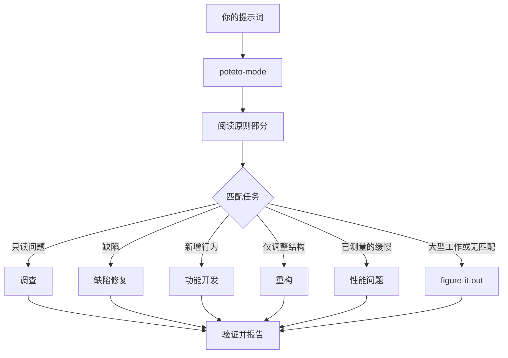

<a id="route-work-through-poteto-mode"></a>

# 通过 `/poteto-mode` 分派工作

`/poteto-mode` 是统一入口。你给它目标，它从二十三份操作手册中选出一份，把步骤复制到待办列表，并在各步骤需要时调用其他技能。本页介绍有效提示词的写法，以及实际所需的内容可以多么简短。


<a id="what-happens-to-your-prompt"></a>

## 提示词如何被处理



图中展示了常见路线。还有一些操作手册用于：持续优化某项指标、诊断运行时症状和捕获的跟踪记录、制作原型、实现视觉一致性、编写和评估技能、自主运行、创建 PR、跟进 PR 或堆叠至可合并状态、交付已验证的堆叠、自动推进 PR 队列或堆叠、编排项目规模的工作、接续会话、安全暂停、多阶段计划，以及清理 Git 工作树。[操作手册目录](../../skills/poteto-mode/playbooks/)列出了完整集合。

<a id="say-the-goal-not-the-ceremony"></a>

## 说明目标，无需规定流程

不必编写规格说明。说清楚哪里不对或你想要什么，再加上你已知、能节省智能体时间的信息：

```text
/poteto-mode 重试后用户会收到两条通知。先复现，再修复并验证。
```

这是一条缺陷修复提示词。“先复现”是真实约束，操作手册会遵守它。你会看到待办列表填入缺陷修复步骤。跳过的步骤仍会显示，并标注 `skip: <reason>`。

<a id="what-goes-in-a-prompt"></a>

## 提示词应包含什么

有用的提示词至多包含五项，每项一句话就够：

- **目标。** 说明哪里不对，或你想要什么。
- **完成检查。** 必须能够判定通过或失败。“改好一点”和“处理一个小时”都不算检查。
- **你想看到的证明。** 要求提供真实命令输出、操作流程视频、存储值，或前后对比数字。
- **已知信息。** 症状、复现步骤、日志行或链接，都能为智能体省下一次搜索。
- **真正的约束。** “先复现”“暂时不要修改任何代码”“行为完全不变”“继续前让我先审查”，都会改变智能体的做法。

下面的提示词包含全部五项：

```text
/poteto-mode 从昨天部署后开始，csv 导出会丢失最后一行。失败作业 ID 为 4812。先复现，再修复。完成标准是导出含 60k 行的测试夹具中的每一行。展示修复前后的行数。
```

两类内容最好先不写：

- **具体做法。** 说明要达成什么，让智能体有空间寻找比你预设的方法更好的路线。技能清单也一样，见下方陷阱。
- **你对原因的猜测。** 明说猜测会把搜索范围收窄到你指向的位置。先让智能体复述问题，再分享直觉。

面对冗杂报告，例如长讨论串或模糊缺陷，让复述成为第一步：

```text
/poteto-mode 阅读这个讨论串。用自己的话，以通俗英语复述根本问题。暂时不要修改任何代码。
```

误读会在尚未写代码时就暴露在复述中。此时纠正，只需一条消息，而不必付出一次错误修复的代价。若只想复述、不运行操作手册，可以运行 [`/in-your-own-words`](../../skills/in-your-own-words/SKILL.md)。它会复述智能体理解的目标，以及你想解决的问题。

如果不确定提示词是否瞄准了正确方向，在发送前用 [`/sharpen`](../../skills/sharpen/SKILL.md) 打磨它：

```text
/sharpen 为 v2 配置格式编写迁移指南。
```

智能体会说明：顶尖专业人士还会做哪些你没要求的事，会从哪些最原始材料着手，会使用什么方法和工具，以及除了你或智能体之外，还有什么能证明结果正确。然后，它会据此重写提示词，让任务更深入而非更庞大，同时保留你的选择空间。它不会执行任务。阅读改写后的提示词，再发送，例如交给 `/poteto-mode`。

<a id="follow-up-short"></a>

## 简短跟进

上下文已在对话中时，提示词可以缩短到几乎什么都不剩。下面这些都足够：

```text
/poteto-mode 执行吧
```

```text
继续
```

```text
持续推进直到完成
```

简短也有效，是因为操作手册提供结构，而自定义模式让 `/poteto-mode` 在每轮对话中都留在上下文里。[设置 pstack](./01-setup.md#run-your-first-task)介绍了启动方式。你的话传达意图，技能负责严谨性。

<a id="switch-tasks-with-new-task"></a>

## 用 “new task” 切换任务

长聊天会累积上一个任务的上下文。更换主题时，请明确说出来：

```text
/poteto-mode new task。查明为什么退出登录后缓存条目还存在。暂时不要修改任何代码。
```

“new task”（新任务）告诉 `/poteto-mode` 重新匹配，而不是继续前一份操作手册。“暂时不要修改任何代码”把这次任务限定为调查。缺少这两句话时，处于功能开发中途的模式往往会把你的问题当成下一步功能开发。

<a id="give-parallel-work-its-own-machine"></a>

## 为并行工作提供独立机器

如果在同一台计算机的同一个仓库运行多个智能体，它们会争用工作目录、端口和构建输出。最彻底的隔离方式是[云端子代理](https://cursor.com/docs/subagents#cloud-subagents)。每个子代理都有自己的 VM 和分支，因此能安装依赖、运行应用并录制结果视频，而不触碰你的机器。在任务前输入 `/in-cloud`，或请父聊天把工作交给云端子代理。

必须在本地工作时，事先要求使用工作树：

```text
/poteto-mode new task。在新的工作树中从 <base> 创建分支，然后把解析器改动移植过去。
```

每项任务拥有自己的分支和工作树，就不会让一个智能体覆盖另一个的文件。工作树消耗磁盘和机器资源，因此笔记本同时只能运行少量工作树。[创建 PR 操作手册](../../skills/poteto-mode/playbooks/opening-a-pr.md)对代码改动已经采用工作树，所以通常只有在特定基线或位置很重要时才需提出这一点。

工作树会越积越多。磁盘吃紧时，可以问：

```text
/poteto-mode 什么占满了我的磁盘？清理能够安全删除的工作树。
```

[工作树清理操作手册](../../skills/poteto-mode/playbooks/worktree-cleanup.md)会根据合并状态、未提交工作，以及哪些聊天仍在使用它，对每个工作树分类。只删除证据允许删除的内容；遇到含未提交工作的工作树，会暂停并由你决定。

<a id="leave-it-running"></a>

## 让它继续运行

离开前，说明完成标准即可：

```text
/poteto-mode 我要暂时离开。持续推进，直到迁移检查报告旧调用方为零。记录你的决策。
```

稍后再由你审查的工作会交给 [`/figure-it-out`](../../skills/figure-it-out/SKILL.md)，由它设计运行阶段，并维护 [`/show-me-your-work`](../../skills/show-me-your-work/SKILL.md) 决策日志。[在你睡觉时继续工作](./07-overnight.md)介绍完整的通宵运行约定。

**陷阱：** 不要在提示词中罗列技能（“先用 /how，再用 /architect，然后 /arena……”）。操作手册已经安排好顺序，手写顺序通常会重排或漏掉本来会保留的步骤。只有想覆盖某个具体选择时，才指定技能。

完整路由规则请阅读 [`poteto-mode`](../../skills/poteto-mode/SKILL.md) 本身。

下一页：[理解代码](./03-understand.md)。
