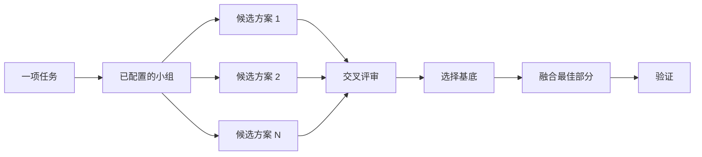

<a id="design-before-you-write-code"></a>

# 写代码前先设计

面对棘手设计，只尝试一次就会把模型最先想到的形态固定下来。`/architect` 在实现前确定类型和边界；`/arena` 对同一任务说明并行尝试多个方案，融合其中最好的部分；`/interrogate` 让其他模型尝试击破结果。当任务侧重覆盖而非设计综合时，`/swarm` 会并行分派切片或竞赛，并汇总结果。

最常见的两种设计错误，是接受智能体的第一个设计，以及反复打磨从未经过代码检验的计划。本页解决这两点：通过代码做规划。原型回答未决问题，README 或教程设定目标，书面计划最后再写。


<a id="settle-the-shape-with-architect"></a>

## 用 `/architect` 确定结构

```text
/architect 在写任何代码前设计导入流水线。我最关心调用方如何使用它。
```

[`/architect`](../../skills/architect/SKILL.md) 会先了解现状：对设计涉及的代码运行 `/how`，涉及职责归属或分层调整时再运行 `/why`。然后运行 `/arena` 产生相互竞争的设计草案；每份草案都先写调用方用法，再写类型、签名和模块图。

默认情况下，它会从综合设计直接进入实现。如果想先看设计，请明确提出：

```text
/architect with checkpoint。在实现前停下来给我看。
```

一旦开始写代码，设计也并非不可更改。如果实现过程中发现互不相关的地方出现相同变通方案，或类型只有使用 `any`、强制类型转换才能编译，`/architect` 会把这些视为设计错误的证据。它会丢弃草案重新开始，而不是绕着问题打补丁。

<a id="fan-out-attempts-with-arena"></a>

## 用 `/arena` 并行尝试

```text
/arena 把我的提示词原样送入 arena。我想把它们的提案与你的作比较。
```

[`/arena`](../../skills/arena/SKILL.md) 是底层的通用工具。N 个子代理并行处理同一设计或代码任务说明，各自在自己的工作树或目录中写入。来自不同模型家族的只读裁判依据评分标准评估每个候选方案。如果没有可运行的其他家族模型，协调者会跳过裁判，自行选择基底。协调者完整阅读每个候选方案，选出基底，移植未胜出方案中的最佳想法，并验证结果。



小组来自你的 [`/setup-pstack`](../../skills/setup-pstack/SKILL.md) 配置，也可按任务调整。决策重要时要求更多候选方案，不重要时减少：

```text
/arena 对这个任务给出 5 个候选方案。缓存键格式后续修改成本很高。
```

<a id="cover-slices-and-races-with-swarm"></a>

## 用 `/swarm` 覆盖切片和竞赛

```text
/swarm 用各自的 check.sh 检查 packages/ 下每个包。每个包一个工作代理。汇成一份报告。
```

[`/swarm`](../../skills/swarm/SKILL.md) 将 N 个工作代理分派到独立切片、覆盖矩阵、连续检查通道、探索分区或已声明的竞赛组。每个工作代理拥有自己的范围和检查，随后报告 `PASS`、`ISSUES` 或 `BLOCKED`。父代理等待所有工作代理，返回一份紧凑报告，指出覆盖缺口或未完成的代理。

当并行能增加覆盖范围，或让独立检查竞速时，使用它。`/arena` 让每个工作代理处理相同的设计或代码任务说明，然后选择基底并融合最佳部分；`/swarm` 则覆盖不同切片，或按事先声明的选择规则进行竞赛，不采用选择基底和移植内容的流程。

<a id="break-it-with-interrogate"></a>

## 用 `/interrogate` 尝试击破结果

```text
/interrogate 审查整个分支，保持怀疑。除非确实是缺陷或回归，否则不要挑细枝末节。
```

[`/interrogate`](../../skills/interrogate/SKILL.md) 把改动和意图交给配置模型上的对抗审查者，每个审查者都尝试通过运行真实代码击破它。不同审查者会发现不同失败。只有重新运行命令能展示违背意图的失败，发现才会被保留。报告列出每项已验证发现及找到它的审查者，再列出各审查者放弃了什么、为什么；它不会应用任何改动。

也请阅读 Dropped（已放弃）列表。你可以推翻它的判断。

<a id="prototype-instead-of-debating"></a>

## 用原型代替争论

不要直接接受第一个设计。要求几个方案，再根据看得见的证据选择：

```text
/poteto-mode 为新的下拉菜单制作几个原型方案。拍截图或视频供我比较。
```

[原型操作手册](../../skills/poteto-mode/playbooks/prototype.md)在临时目录构建可丢弃的草案，把各变体放在同一个切换器后，逐一操作，并捕获截图或计时。它也适用于行为和算法，不限于 UI。原型就是通过代码做规划：让智能体通过运行实际内容回答自己的未决问题，而不是向你提问，同时为你未曾想到的选项留出空间。

同样的思路可以扩展到正式设计。将 `/architect` 与原型结合，并保留审查门禁：

```text
/poteto-mode 我们需要为外部 webhook 增加限流。先用 /architect 设计，再通过原型回答未决问题。继续前让我审查。
```

不要把对抗审查资源花在抽象计划上。`/interrogate` 会丢弃所有无法通过运行证明的发现，因此没有代码支撑的计划几乎没有可供攻击的对象。先让原型解决问题，再审查实际构建的内容。

<a id="write-the-readme-first-for-shared-code"></a>

## 共享代码先写 README

对于供其他代码使用的包或 API，从用户会阅读的文档开始：

```text
/poteto-mode 先写一份介绍我如何使用新配置包的教程。然后用 /teach 向我解释为什么它优于当前方案。
```

先写教程会迫使你采用调用方视角：向假想用户描述 API，再倒推实现。文档也成为智能体检查自身工作的具体目标。如果文档本身很重要，请指定 [`/technical-writing`](../../skills/technical-writing/SKILL.md)，让教程保持教程形态，而不是同时混入参考资料和概念解释。

<a id="plan-after-the-design-settles"></a>

## 设计确定后再规划

pstack 刻意不提供规划技能。确实需要书面计划时，等设计确定后再提出：

```text
/poteto-mode 把这个设计变成计划。拆成小而可验证的 PR，每个 PR 都有自己的验证步骤。
```

[多阶段计划操作手册](../../skills/poteto-mode/playbooks/multi-phase-plan.md)先通过原型解决剩余未决问题，然后每个 PR 写一节，每节以证明改动有效的证据结尾。只有测试套件通过不算这种证明。计划本身就是交付物；操作手册不会实现它，而是指出下一步应由哪份执行操作手册来实施。

对于迁移，在提示词中明确标准：

```text
/poteto-mode 规划把我们的 ui 库迁移到新的样式系统。拆成小而可验证的 PR，每个都有视觉回归检查。结果必须与原版完全一致，包括缺陷。
```

“包括缺陷”能防止迁移过程中悄悄修复问题，否则新旧输出将无法比较。对于跨越多天的项目，可以暂时把计划提交到仓库，让其他智能体看到正在进行的工作。改动落地后删掉它。

<a id="how-much-design-work-does-a-task-deserve"></a>

## 一项任务值得投入多少设计工作？

并非每次改动都需要这些。大多数改动完全不需要。可大致按以下层次判断：

- 小型且已完成、但你不太放心的改动，只需要 `/interrogate`。
- 跨越函数边界或调整职责归属的改动，值得使用 `/architect`，它会一并调用 `/arena`。
- 命名、格式或算法这类能从独立尝试中获益的单独决策，直接用 `/arena`。
- 覆盖矩阵、一组并行检查，或明确声明各组的竞赛，用 `/swarm`。
- 布局、耗时或实现方式等可以通过运行回答的开放问题，应做原型，不必争论。
- 有争议且回退成本高的设计，先用 `/architect`，交付前再用 `/interrogate`。
- 跨多个 PR 的工作，等设计确定后编写计划。

`/poteto-mode` 已经应用这套层次。跨边界工作会自行触发 `/architect`，因此你通常只在希望审查力度高于或低于默认值时才直接调用这些技能。

下一页：[构建并清理改动](./05-build-and-clean.md)。
