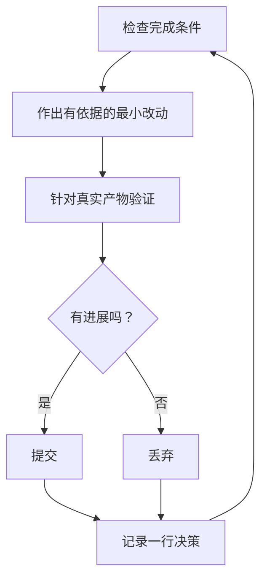

<a id="run-work-while-you-sleep"></a>

# 在你睡觉时继续工作

前面所有准备的回报就在这里。能信任它验证自身工作的智能体，就可以独自承担困难任务。让这一切安全的不是希望，而是可检查的完成条件、隔离的工作树或云端智能体，以及早晨由你审计的决策日志。


<a id="earn-the-trust-before-the-loop"></a>

## 先建立信任，再运行循环

不可信的循环只会更快地产生未经检查的工作，混乱还会随着每次迭代累积。让它独自运行前，确认它已经满足以下条件：

- 你手动完成过一次任务，或看过智能体完成，因此知道什么算好结果。
- 智能体拥有你自己会使用的工具和信号：验证技能、性能分析器、日志。
- 每个阶段都证明自己的工作，达不到标准时能停止整条流程。
- 你读过几份对话记录，并把反复出现的失败变成工具、技能或检查。

四项全部成立后，才让循环自主运行。在此之前，请边观察边运行。

<a id="the-overnight-contract"></a>

## 通宵运行约定

良好的交接包含目标、完成条件、权限和退出机制，不必很长：

```text
/poteto-mode 我要睡觉了。在从 <base> 新建的工作树中，把所有调用方迁移到新解析器。
完成标准：旧调用方为零，所有解析器测试夹具通过，旧 api 已删除。
保留决策日志。提交前不用问我。
/loop 直到完成。如果几小时后确实走不通，就停止并写明原因。
```

逐行看看它们的作用：

- “我要睡觉了”是会话级覆盖，智能体会停止提问并继续推进。
- “完成标准……”把目标变成每轮迭代都能运行的检查。
- “从 `<base>` 新建的工作树”避免本次运行与其他已打开的工作冲突。
- “提交前不用问我”预先回答了智能体原本可能等待的权限问题。
- `/loop` 是 Cursor 内置唤醒机制，不是 pstack 技能。[自主运行操作手册](../../skills/poteto-mode/playbooks/autonomous-run.md)用它在事件发生或定时心跳时重新检查完成条件。
- 退出机制允许它在真正走不通时停止并写明原因，胜过花八小时创造性地重新解释目标。

因为你会在离开后审查工作，`/poteto-mode` 会把它交给 [`/figure-it-out`](../../skills/figure-it-out/SKILL.md)，在写任何代码前设计运行阶段并接入决策日志。

要主动停止运行，请告诉智能体暂停，或说你即将离线或重启 Cursor。[安全暂停操作手册](../../skills/poteto-mode/playbooks/pause-safely.md)会完成或撤回当前步骤，提交一个进行中检查点，并写下恢复说明。新的聊天会通过会话接续操作手册，从该说明继续工作。“继续推进”绝不会触发暂停。

<a id="what-the-loop-does-all-night"></a>

## 循环整夜做什么



每轮迭代都是一项改动、一次检查、一行日志。无助于目标的改动会被丢弃，不会留着一起交付。进入平台期意味着转向，而不是停止；完成条件绝不会悄悄放宽以宣布胜利。

<a id="the-morning-audit"></a>

## 早晨审计

[`/show-me-your-work`](../../skills/show-me-your-work/SKILL.md)让运行过程可审查。每行记录时间、阶段、决策、理由、证据指针和结果，保存在 `decisions.tsv`（多个运行共享目录时则为 `.audit/<task-slug>.tsv`）。默认保留在本地。当工作规模足够大，审查者需要记录才能信任结果时，提交它。

回来后，请求以审查形式回顾运行：

```text
/show-me-your-work 帮我回顾你昨晚做了什么
```

在返回摘要前，技能会派出不同模型家族的审查者阅读记录和对话；回复末尾的 Attention（需关注）部分列出值得仔细检查的内容。先读这一部分，再读它指向的日志行。你是在审计决策，而不是重读整晚的过程。

若只想快速看状态而非审计，在执行工作的聊天中运行 [`/ketchup`](../../skills/ketchup/SKILL.md)。它只读，用通俗语言说明自你上一条消息以来的变化，并附工作产生的截图和小图示。然后列出每个等待你决定的事项，例如合并、批准或选项选择，并给出它的推荐、证据和风险，让你仅凭回复就能作决定。

<a id="when-the-night-holds-a-queue-not-a-task"></a>

## 一整夜面对的是队列，而非单个任务时

上面的约定把一个任务推进到一个完成条件。有些夜晚工作更多，是独立改动的队列，或一整项工程。三份操作手册把同样的信任扩展到更大规模。

[Autopilot-full](../../skills/poteto-mode/playbooks/autopilot-full.md)把独立 PR 队列推进至合并。每个 PR 有一位负责智能体，从构建一直推进到合并；没有任何负责人可以依据自己的判断自行合并。一组全新验证代理检查负责人宣布代码就绪的 HEAD。之后的变基或小修复由一个新的验证代理检查，只有新增行为或较大的新差异才会再次调用整个验证组。只有针对实际合并补丁的清洁结论，才授权合并：

```text
/poteto-mode 对这个队列运行 full autopilot。各条目相互独立。我希望早晨前全部合并。
```

[Autopilot-stack](../../skills/poteto-mode/playbooks/autopilot-stack.md)是不会合并的 Autopilot-full。醒来时，你会看到已验证的 PR，每个都带结论，再由你审查并落地。一个 PR 只有依赖另一个 PR 时才会叠在它上方。如果想在任何内容合并前亲自看过工作，就选择它而不是 Autopilot-full：

```text
/poteto-mode 自动推进这五项改动，但不要合并。我早晨自己落地。
```

[Orchestrate](../../skills/poteto-mode/playbooks/orchestrate.md)适合生命周期超过任何单个智能体的工程：持续多天、大量堆叠 PR，以及由一个常驻协调聊天管理的大批子代理。协调者决定每项工作由哪个智能体完成，检查其产物，自己绝不写代码。如果一个智能体能在一次会话内完成，操作手册本身会把你导回上面的通宵运行约定：

```text
/poteto-mode 编排 store 迁移。持续负责，直到每个包都转换并合并。我每天查看两次。
```

<a id="run-many-projects-in-parallel"></a>

## 并行运行多个项目

[Cursor Project](https://cursor.com/blog/projects)为一个协调智能体提供持久聊天。协调者不写代码，而是指挥默认在云端运行的子代理，因此笔记本合上后工作仍会继续。这正是 Orchestrate 操作手册预期的形式。向协调者发提示时，以 `/poteto-mode` 开头，它启动的子代理就会遵循操作手册。

一些有用的习惯：

- 每组工作拥有自己的 Project，例如一项功能、一次迁移、一轮性能优化或技术债清理。多个项目可以并行。
- 将相关聊天拖入 Project，包括已完成的聊天。它们会成为其中每个智能体的上下文。
- 每个 PR 合并前都经过验证代理组检查，让 Autopilot-stack 或 Autopilot-full 推进队列。
- 要求协调者提供数据支撑的计划，并在向你提问前用原型回答未决问题。

一条提示词就能承载整个 Project，从研究到执行：

```text
/poteto-mode 重构这个仓库，使架构更适合智能体。用 /correct 和 /architect 分析历史提交及审查评论，找出智能体在这里最常犯的错误。用 /recall 获取过去聊天的上下文。通过原型回答未决问题，不要问我。带回一份由真实数据支撑的计划。等我批准后，用 autopilot-stack 或 autopilot-full 执行，并问我选哪一个。
```

<a id="let-loops-start-themselves"></a>

## 让循环自行启动

以上每种循环仍等着你启动。定时或事件驱动的自动化能省去这一步。软件维护可以拆成很适合自动化的阶段：分流报告、复现、修复、验证修复。两条规则保证流程可信：

- 每个阶段都能停止整条流程。分流可能判定报告是预期行为，复现可能无法重现，修复者可能认为改动风险过高。这些结果都很有用，因为它们阻止不合格工作进入下一阶段，避免在更高成本处撤回。
- 每个阶段都交付证据。复现附上故障状态的截图和视频，修复附上前后证明。这样，人类在读任何一行代码前，就能检查智能体是否修对了问题。

pstack 为 Slack 问题报告附带了一个默认不启用的[自动化包](../../automations/benny/README.md)。一个自动化对每份报告分流；另一个复现确认的缺陷，并可能准备一份小型草稿修复。要设置它，请让智能体阅读 [`FOR_AGENTS.md`](../../automations/benny/FOR_AGENTS.md)，并指定目标仓库。

**陷阱：** 时长不是完成条件。“处理这个任务 4 小时”没有给智能体任何可检查的东西，醒来看到的只会是四小时的忙碌，而不是结果。给 `/loop` 一个可以判定真假的条件。

下一页：[用原则名称引导工作](./08-principles.md)。
